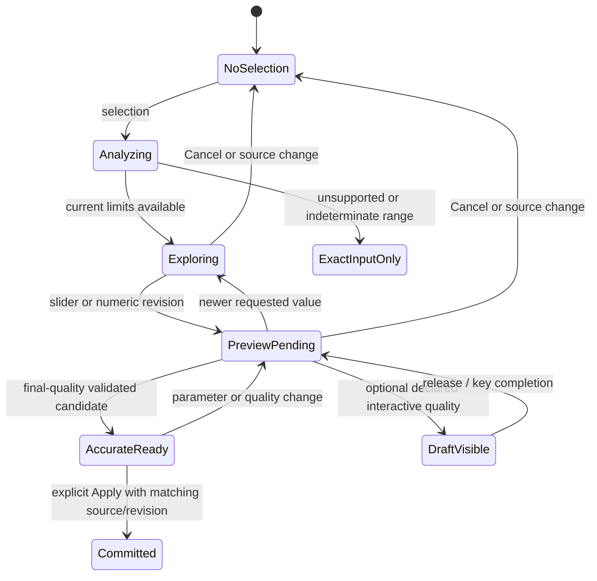

# Unified Edge Treatment controls and geometry foundation

Modularity constraint: see [the source-level modularity audit](EDGE_TREATMENT_MODULARITY_AUDIT.md). Retain dedicated feature strategies and adapters; shared-core extensions must be minimal, generic where justified, and reviewed before implementation.

Status: architectural and interaction proposal for review; **not implementation approval**.

Verified local HEAD and remote `feature/edge-treatment`: `ebb06e4f4a049a9a0c08f7d9acbe09d5c5482816`. This assessment uses the integrated Phase 2 code, including batch geometry, candidate ownership, selection, actual segment counts and the final tooltip fixes. No source, dependency, model format or installed application is changed.

This document updates the *sequencing* of the [Phase 3 architecture report](EDGE_TREATMENT_PHASE3_ARCHITECTURE.md) and [test matrix](EDGE_TREATMENT_PHASE3_TEST_MATRIX.md). Sequential treatments, polygon perimeters and circular/mixed boundaries must be developed **in tandem against one control/evaluation contract**. They are not separate tools, and the control panel is not a cosmetic layer postponed until after the geometry engine. Existing findings and Category A/B/C distinctions remain applicable; unsupported cases do not become supported merely by this design.

## 1. Decisions and recommendation

Build one source-bound treatment request and evaluation pipeline with these responsibilities:

1. Analyze current geometry, selected boundary and prior treatment effects.
2. Determine operation eligibility, parameter-domain constraints, accuracy feasibility and expected work.
3. Return an honest range description, distinguishing proved constraints from sampled/conservative endpoints.
4. Evaluate a revisioned preview, with declared quality and cancellation semantics.
5. Publish a final candidate only after full requested accuracy and geometry/export validation.
6. Commit atomically through the existing document action, leaving an evaluated solid that can be analyzed for the next operation.

Keep the existing Phase 2 evaluator as a compatible strategy behind this interface. Extend capabilities through shared cap/boundary/patch evidence, not a frontend box-size formula or unrelated polygon/circle/sequential tools. No new dependency, replacement kernel, global feature tree or competing measurement system is proposed.

Recommended initial controls: native range input plus the existing editable text input, with precise canonical meters, unit-aware keyboard increments, geometry-owned bounds and coalesced previews. Ordinary fast cases can use exact-quality evaluations. The measured expensive case requires an asynchronous/resumable evaluation strategy before claiming uniformly responsive high-quality interaction. Debounce alone is insufficient.

## 2. Existing code and verified gaps

| Existing implementation | Reuse / missing capability |
|---|---|
| `app/src/panels/EdgeTreatmentPanel.tsx` | Keep contextual layout, operation-specific fields, CSS variables, information buttons, status, acknowledgment and Apply/Cancel. No dimension slider exists yet. |
| `app/src/panels/MaterialPalette.tsx`: native `input type="range"` controls | Reuse native-control/accessibility conventions, not its opacity bounds or commit-on-release semantics for geometry. No general unit-aware geometric slider component was found. |
| `app/src/tools/EdgeTreatmentTool.ts`: `canonical`, `configure`, `requestPreview`, `generate`, `release`, `apply` | Reuse owned transient groups and native candidate lifecycle. Current 180 ms trailing debounce can postpone every preview during a continuous drag. `release` combines candidate retirement and GPU cleanup; drag-specific stale visuals would require a narrow separation of those responsibilities. |
| `app/src/settings/units.ts`: `parseLengthToMeters`, `formatLengthIn`, `getLengthUnit`, `getLengthSystem`, `getPrecision`, `metersFromUnit`, `subscribe` | Authoritative parser/conversions/display preferences. Precision changes notify subscribers even when format does not change. No new parser or duplicated inch constants. |
| `app/src/settings/useLengthDisplay.ts`: `useLengthDisplay` | Existing React subscription to format **and precision**. Use it for readouts rather than a format-only state subscription. |
| `crates/kernel/src/edge_treatment.rs`: `resolve_edge_frame`, `check_clearance`, `evaluate_cut`, `roundover_segments` | Existing scalar geometry, clearance and quality checks. No located valid-parameter-range query. |
| `crates/kernel/src/edge_treatment/multi.rs`: `BoxFrame::resolve`, `batch`, `intersect_boundary`, work/segment limits | Whole-selection constraints and corner cost already live in Rust. Current scalar and batch restrictions differ. Do not calculate a batch limit by taking the minimum of scalar limits. |
| `crates/kernel/src/document/edge_treatment.rs` | Snapshot/generation compatibility, source identity, pure preparation and atomic commit. Reuse without exposing a partly validated object. |
| `crates/wasm-api/src/edge_treatment_api.rs`: `prepare_treatments`, `treatment_context`, `treatment_target` | Scene ownership/context plus actual STL certification before publishing a handle. Probing through current public prepare methods would replace the visible candidate; a separate nonpublishing query path is needed. |
| `crates/mesh-export/src/roundover_precision.rs` | Export-precision checks belong here, outside the pure kernel. A kernel geometric bound alone is not a certified end-to-end slider bound. |
| `app/src/wasm/loader.ts`; `app/src/panels/ImportingOverlay.tsx` | Current modeling API is synchronous. The import overlay explicitly documents main-thread blocking; there is no existing cancellable geometry worker facade to assume reusable. |

### Two precision/context findings that affect the design

**Display preferences are currently global, not documented per-model units.** `units.ts` explicitly describes a localStorage-backed display singleton which never changes kernel state; `.hew` geometry is f64 meters. No per-document display-format/precision API was located in the inspected treatment, settings and native-format paths. The initial controls should consume Hew's existing active display context through a replaceable provider. If genuinely different saved unit preferences per document are mandatory for the first release, that is a separate upstream-approved persistence/load-context requirement. Do not silently create a filename-keyed preference store or claim the current singleton satisfies it.

**The existing “exact” formatter is a readout, not lossless editable serialization.** An actual browser call on the current code produced:

| Expression | Result |
|---|---|
| Parse `0.0125"` | `0.0003175` meters |
| Parse `0.3175 mm` | `0.0003175` meters; conversion difference zero in this probe |
| `formatLengthIn(value, 'mm', 'exact')` | `0.318 mm` |
| Parse that displayed text back | `0.00031800000000000003` meters |
| Exact decimal-inch readout | `0.0125"` |

The formatter intentionally uses a 1 µm display round-trip target and finite decimal ceilings. This is **display rounding**, not evidence that current canonical geometry changed. A naive slider handler calling `configure({radius: formatLengthIn(...)})` could, however, delete the canonical cache and reparse the rounded value. It must not be implemented that way.

## 3. Proposed interaction and component design

Illustrative layout; the range below is an engine result, not a fixed numerical maximum:

```text
Edge Treatment
Operation: [Roundover v]
Selected edges: 4       [Select face perimeter] [Clear]

Radius (i)
[--------o----------------]  [0.3175 mm           ]
Validated exploration limit: {engine result} (i)

Maximum chord error (i)      [0.05 mm             ]
Segments per quarter arc: {actual completed preview count}
{Updating / Accurate preview ready / actionable diagnostic}

[Preview] [Apply] [Cancel]
```

Chamfer mode shows Distance and hides chord error. Preserve all existing tooltips and warning acknowledgment. A small panel-local `TreatmentDimensionControl` can combine a labeled native range, a separately labeled text input and constraint/status text. This is a proposed component, not an existing one. Keep tool state authoritative; do not make the component know solid families.

The text input remains `type="text"`, so existing explicit units, fractions and inch marks work. The numeric value is not an HTML number-input grid. Retain raw draft text separately from parsed requested meters and the last completed candidate's parameters. Do not replace incomplete/invalid text while the user is editing it, and never create a history entry from typing or dragging.

Use `step="any"` for the native slider so its DOM value cannot quantize a manually typed dimension. A normalized 0–1 thumb coordinate is acceptable **only as a UI mapping of Rust-supplied physical endpoints**, not an arbitrary physical maximum. On a slider-origin event, write canonical meters directly and generate edit text from that value; do not route it through a rounded readout and parse it back.

Freeze the physical-to-thumb mapping for an active drag. Defer outward, same-context range refinements until release so background analysis does not move the thumb under the pointer. A source/selection/quality change cancels that mapping immediately; it is not a reason to retain stale limits.

Provide a small editing formatter in the existing units module, sharing its unit definitions and parser grammar. Its goal is round-trip precision near floating-point conversion limits, not the current micrometer display target. Preserve canonical values even when a display conversion cannot round-trip bit-for-bit. Specify/test a named floating-point conversion budget; never round the model value to the slider increment. Ordinary secondary readouts respect `getPrecision`; the editable field and safety endpoint may show additional digits needed to state the actual dimension. A displayed maximum must never round upward and imply a rejected boundary is valid; increase its display precision or explicitly label it approximate/conservative.

When a typed value is beyond a **proved** ceiling, keep the text, invalidate Apply and explain the native reason. Above a **conservative exploration endpoint**, do not automatically call it geometrically invalid: evaluate the exact entry. A successful fully validated value can extend the exploration endpoint. A failed request leaves the committed solid intact. If the thumb cannot represent an invalid/out-of-range draft, retain a clearly labeled last-valid position (or disable it temporarily); never silently overwrite the draft with the range element's clamped DOM value.

### Keyboard and pointer contract

- Arrows adjust the slider using a unit-aware exploration quantum; Shift provides finer steps if viewport modifier handling can be isolated safely. Page Up/Down use a larger multiple. Increments affect slider-origin changes only.
- Home/End move to the actual validated exploration endpoints. Zero remains an invalid operation unless a separately reviewed no-treatment state is introduced; do not submit a zero-radius cut as a valid endpoint.
- Derive decimal/fractional exploration increments from the current format/precision and useful span, using existing unit conversions. “Exact” has no finite display grid, so select a documented interaction quantum; it never defines numeric accuracy.
- Range arrows, Space, Home/End, Page keys and Enter must not invoke camera or viewport Apply shortcuts. Enter finishes an adjustment; it does not silently commit from the new range control. Preserve existing text-field/Apply behavior unless an explicit interaction change is approved.
- Pointer release, key-repeat completion, blur and explicit Preview all schedule accurate evaluation. Do not rely exclusively on pointerup. Pointercancel retires the drag candidate and restores the pre-gesture parameter state if its source context still matches; Escape keeps existing tool cancellation semantics. Tooltip Escape closes help first.
- Use visible focus styles, separate accessible names for slider and exact field, descriptive constraints, `aria-valuetext` in active units and restrained live-region announcements. Do not announce every pointer event. Test actual touch/click, not only programmatic change events.

## 4. Shared geometry, limit and evaluation contract

The proposed logical request is a source/context token, canonical selection, treatment assignments, the parameter being varied, fixed parameters, final accuracy policy and evaluator version. V1 varies the common distance or radius; later groups can vary one assignment while the others remain fixed. Units/display precision are not geometric inputs.

Native analysis returns eligibility, derived parameter constraints, boundary/event evidence, expected patch/segment/work counts, accuracy feasibility and diagnostic provenance. Proposed range metadata includes:

| Field | Meaning |
|---|---|
| `schema_version`, `source_context`, `request_revision` | Stable interpretation and stale-result protection |
| `operation`, `varying_parameter`, `fixed_parameters` | Full operation domain, including chord error and other groups |
| `status` | Ready, unsupported, proved-empty, analysis-pending/budget-exhausted, or indeterminate; these are different outcomes |
| `geometric_ceiling` / `policy_ceiling` / `quality_ceiling` | Optional derived constraints with reasons and open/closed boundary semantics |
| `validated_min`, `validated_endpoint`, `bound_kind` | Whole-operation tested values; `certified_interval`, `conservative_endpoint` or `sampled_endpoint`, never an unqualified exact maximum |
| `domain_components` / `unresolved_regions` | Room for discontinuities; no assumed single valid interval across all future geometry |
| `limiting_constraints`, `diagnostics` | Evidence-based explanations, not guessed self-intersection or clearance |
| `work_estimate`, `cost_class`, `quality_policy` | Scheduling/capacity information; prediction is not proof of timing |

Names are proposals. No such range API currently exists. To match current Scene conventions, an initial public proposal could use `chamfer_limits_json(object, edges)` and `roundover_limits_json(object, edges, max_chord_error)` backed by one internal request type. Any optional seed is a search hint, not a caller-specified arbitrary maximum. Public signatures need review before implementation.

Keep pure source analysis/planning in kernel child modules; Scene orchestrates context, document snapshots and mesh-export precision certification. Kernel must not depend on mesh-export or frontend code. Probes evaluate the same operation and final-quality checks as real preparation, then drop their temporary geometry. They must not mint/retire public candidate handles, modify the prepared slot, change source metadata, record calls or alter history. Querying while a valid preview exists must leave that preview's handle usable.

A matching already-certified candidate can contribute a checked search seed without retiring it. A seed supplies evidence about that value, not proof of a whole interval or an arbitrary maximum. Return a provisional/refining status until useful bounds are established, and prioritize the visible requested preview over background limit refinement.

Reuse source eligibility evidence for an immutable snapshot, not by skipping validation on a different source. Expensive analysis/search must be resumable/off-thread where necessary. A fixed probe-count budget does not bound the duration of a single synchronous probe.

### Exact versus conservative limits

For Phase 2 batches, Rust currently enforces `2*size < shortest_box_dimension - PLANE_DIST`, but actual acceptance also depends on all selected junctions, volume resolution, section/plane budgets and serialized STL precision. Roundover limits additionally depend on chord error; chamfer limits need a separate evaluation. Scalar clearance uses its own frame/support checks. The UI must not reproduce any of these formulas.

A strict geometric supremum may be degenerate and is not itself admissible. A floating-point predecessor alone is not a safety certificate: topology, volume and f32 export can fail before that boundary. Use named native margins and validate the entire operation at a conservative endpoint.

For a search fallback, first derive a finite geometry/quality upper bracket in Rust, seek a fully valid positive seed, and refine only a domain whose relevant constraints have justified monotonic behavior. Distinguish proven clearance/quality failure from numerical or validation uncertainty. **Do not binary-search the entire prepare-success predicate as though it were always monotonic.** Segment transitions, precision failures, curved offsets and interacting sequential regions can invalidate that assumption.

If proof is incomplete, report the largest *checked feasible* endpoint as conservative/sampled, retain unresolved gaps and validate every actual requested value. A tested endpoint does not prove every smaller value valid. If a guaranteed continuous interval is required, only enable that mode when the engine has certified the interval; otherwise retain exact input and explain the limitation. Do not claim “no positive treatment exists” merely because a bounded search found none.

For multiple feasible components, use a declared current component or disable the continuous slider until the domain can be represented honestly. Never span a known invalid gap with an apparently safe continuous range. Initial operation contracts should stop before offset-topology events rather than silently choosing a different result topology.

## 5. One geometry foundation for the three coordinated capabilities

The common abstraction should be a **certified treatment neighborhood and boundary**, not an untouched rectangular-prism detector. Reuse the old box strategy for compatibility while adding shared capabilities:

- Current-source/cap-band evidence, material-side orientation and influence region.
- An ordered boundary view preserving Line/CircularArc semantics, source attribution and stable correspondence through offsets. Use existing Profile/CurveGeom machinery and adapt to approved True Curves APIs rather than inventing a rival general curve library.
- A treatment section law: linear for chamfers; circular for constant-radius roundovers. Its dimensions and accuracy policy are independent of display units.
- A plan of shared evaluated boundary constraints/patches, explicit junction policy, cost estimate and validation expectations. Reuse the indexed builder where its convex assumptions hold.
- A result with validated geometry, preserved outside-region geometry/attributes and sufficient honest provenance for the next eligible operation. A successful first cut must not become unusable solely because the source is no longer an 8-vertex box.

| Capability | Coupled planning/limits | Preview and final validation obligations |
|---|---|---|
| Sequential current solids | Certify the new cap/region band against existing treatments, not original box counts. Hold previous dimensions fixed; detect overlap and first collision. | Preserve earlier geometry/ancestry outside the band; prepare the exact Fedora top-after-bottom sequence; test both orders, independent dimensions, save/load and next-operation eligibility. No full feature graph prerequisite. |
| Polygon perimeters | Shared cap/wall frame, offset events, acute-corner miters and entire-loop constraints. No side-count algorithms. | First square/trapezoid/hexagon/octagon and irregular variants; cylinder bands and declared miter seams, independent faceted/ideal removal checks, real-WASM lifecycle. |
| Circular/mixed boundaries | Recover actual circular runs, source approximation and curvature/feature-size constraints. Smooth line/arc joins and sharp junctions are different. | A genuine circle is not a collection of unrelated single-edge cuts. Establish toroidal/linear patch targets, shared seams, error bounds and persistent source semantics compatible with True Curves. Start with circle and convex tangent rounded-rectangle/mixed contours; concave mixed paths remain explicitly gated. |

Selection must retain semantic provenance as well as current handles. Face-perimeter selection can already gather facet IDs; the native boundary resolver should identify an attributed circular run or tangent mixed contour without a frontend side-count heuristic. Preserve `SketchCurveKind::Polygon` versus circle ancestry. An untagged regular polygon must not become a true circle merely because it has many sides. Adapt logical curve/span references and selection summaries to the agreed True Curves interfaces; do not freeze raw facet indices as permanent curve identity.

For an ideal convex circular cap of source radius `R`, top roundover radius `r` has meridian `rho=R-r+r*cos(theta)`, `z=H-r+r*sin(theta)` over the quarter arc. This is a finite toroidal patch, with major radius `R-r`, not a cylinder band. Current persistent `SurfaceRef` has no Torus variant. A certificate for an infinite/full torus is insufficient unless the finite patch domain is also checked. Do not copy sphere/cylinder triangle tests and assume they prove torus deviation.

A common offset-band parameterization can cover convex polygonal, circular and tangent line/arc caps: successive inward offsets plus the shared section law. Polygon miters and circular offset radii follow their actual primitives. Constant-topology and first-event checks are shared; representation, certificate and collision work differ. Initial convex curved strategies may reuse half-space construction if its approximation/locality proof is established; general nonconvex paths require region-limited trimming, not globally extended cut planes.

For convex C1 circle/line-arc contours before offset events, the offset area coefficient is pi; polygon miters use the angle coefficient described in the Phase 3 report. Use the correct target and independent measurements, not polygon formulas mislabeled as continuous-circle accuracy.

### True Curves and the source-envelope decision

The inspected upstream main remains `f23fc98bd79cb24b617f93ac96ad0601fe4a3c42`. Existing circle/cylinder metadata is present, and public discussion describes forthcoming fillet work; the API/semantics of an unpublished future True Curves implementation are not verified. Coordinate those decisions before freezing new curve/surface types or persistence.

The current faceted carrier and its ideal circle ancestry are not interchangeable containment envelopes. Refining an inscribed circular polygon by adding ideal-circle stations can place new material outside the old carrier. A subtractive treatment must not silently do that.

Default legacy behavior remains strict containment in the current authoritative carrier. For genuine curved treatments, explicitly define the upstream-approved source authority and total approximation budget. If an ideal curved result cannot meet tolerance inside the coarse carrier, refuse with an actionable source-resolution explanation or require an explicit source-refinement operation. Do not silently change the source below/outside the treatment band. If True Curves makes an analytic solid authoritative, source refinement and containment must use that declared semantic contract consistently, not a UI-only exception.

Curved outputs must remain valid inputs to independent subsequent operations. Preserve untouched curve/cylinder attribution and map-or-drop rules, and certify the new influence band on the current source. Test after save/load. New torus or procedural patch persistence must align with upstream versioning, validators, exporters and naming; do not hide an incompatible private schema in arbitrary attributes. Not every generated edge must immediately support every treatment, but the tested independent opposite-cap sequence must work, with clear diagnostics elsewhere.

## 6. Revisioned live-preview flow



Accuracy is one final geometry contract even when its implementation budgets section, path and junction tessellation separately. Curved previews should distinguish section segments, path stations and total triangle count when useful; the existing quarter-arc count alone cannot explain surface complexity. Keep the beginner-facing accuracy field simple and place additional counts in optional detail. No source/path budget may silently consume more than the declared final tolerance.

Maintain separate source/selection revision, physical range key, preview revision and displayed-preview parameters. Physical range keys include source/context, selection, operation, fixed assignments, requested final chord policy and evaluator version. The varied radius/distance is not automatically a domain-key change; do not restart a full limit search on every slider tick. Display-unit and precision changes reformat state without recomputing physically identical bounds or geometry. Finite canonical parameter bit identity can deduplicate identical requests; do not use a geometric epsilon to merge distinct exact user entries.

Render the thumb/text immediately, retain only the latest requested evaluation, and use a leading/coalesced update cadence rather than trailing debounce alone. Never build a queue of obsolete previews. During a same-source drag, the last completed mesh may remain dimmed and explicitly marked as previous/updating, with Apply disabled. Clear it on selection/source changes or invalid input. Numeric editing can retain current conservative cleanup behavior; keeping a drag visual must not weaken handle retirement.

Apply is enabled only for a native final candidate matching the current source, selection, canonical values, requested chord policy and request revision, with acknowledgment current. Pointer release is not Apply. A cached mesh, range-query result or low-quality draft is never a committable candidate. Scene snapshot/generation checks remain the final authority even after UI checks.

Retire stale handles promptly; free old native wrappers, temporary meshes and GPU buffers. Cache a small bounded amount of range metadata and, only if profiling warrants it, immutable preview data. The Scene currently has one prepared slot: do not cache/reuse retired tokens as if they were multiple native candidates. No preview/probe/cache state goes into model history or recordings.

## 7. Measured performance and asynchronous strategy

An inspection-only Node WASM probe used a fresh 100×60×20 mm box, two warm-up runs and five measured evaluations per row. Each evaluation included preparation/certification, preview mesh extraction/buffer copies and discard; no GPU rendering or document commit. Original saved bytes/history remained unchanged.

| Roundover selection | Radius / chord, mm | Section segments / triangles | Median / observed max, ms |
|---|---|---|---|
| One edge | 2 / 0.05 | 4 / 28 | 3.03 / 3.31 |
| Three incident edges | 2 / 0.05 | 5 / 102 | 2.04 / 2.33 |
| Face perimeter | 2 / 0.05 | 4 / 44 | 0.81 / 4.51 |
| All twelve | 2 / 0.05 | 5 / 492 | 9.74 / 10.33 |
| All twelve, fine | 6.35 / 0.01 | 20 / 6732 | **883.22 / 893.40** |

These are development-host samples, not Fedora, browser/GPU measurements or statistically established percentiles. A separate whole-operation check accepted a 6.35 mm all-edge chamfer but refused the same-sized roundover at 0.005 mm chord error with `ApproximationTooFine`. This demonstrates operation/quality-dependent feasibility, not an exact located maximum.

The expensive case rules out a design which simply wraps synchronous WASM in a Promise, AbortController, rAF or a 180 ms debounce. Those do not interrupt CPU execution. Generation IDs suppress stale publication, not CPU work already inside a call.

### Recommended scheduling policy

1. Cache source-bound eligibility/work evidence and expose estimated work before expensive probing. Box corner work includes selected-edge section planes and n² spherical grids; polygonal bands scale with perimeter stations × section stations; curved paths require adaptive sampling and patch certificates; sequential requests include existing-face collision/attribute work. Never model all three by edge count alone.
2. Use full-quality, latest-only coalesced previews for measured fast cases. Establish real browser/Fedora latency and input-response gates before choosing a cadence. Tentative engineering targets are thumb updates at the next frame and no repeated >50 ms main-thread tasks during ordinary dragging; these are acceptance targets, not achieved claims.
3. Profile the expensive evaluator's construction, source/result validation, certification, tessellation and transfer stages. Then make existing evaluation resumable with bounded work units, or offload immutable evaluation. Do not duplicate the geometry algorithm. A source-bound job can advance a limited set of constraints/vertices/triangles, yield, cancel and publish only after every final check succeeds. Deterministic iteration order must preserve replay behavior. Single uninterruptible stages still need measurement; a work-count limit is not itself a time guarantee.
4. A worker alternative may own an independent WASM instance and immutable snapshot, returning tagged metadata/copied buffers. Runtime edge IDs can change when loading that snapshot: resolve stable source identity and exact references, not copied slot IDs. Never transfer Scene wrappers or accept worker-native candidate tokens in the main Scene; separate module instances can mint colliding handle numbers. Final authoritative preparation/validation must still occur in Rust without trusting a JavaScript “validated” flag. Moving the entire authoritative Scene to a worker is a much broader app change and is not a free UI optimization.
5. An optional lower-quality drag preview may use a separate, visibly declared interaction quality without changing the entered dimensions or stored final chord setting. It must retain valid closed geometry and source containment; a final-tolerance/work failure cannot be hidden by a coarse success. Release/Apply requires accurate evaluation and certification. Until asynchronous accurate evaluation is reliable, do not claim the 883 ms case is responsive merely because its draft is fast.

Initially keep range queries and geometry jobs separately cancellable but governed by the same source token. Supersede obsolete jobs, prioritize the latest visible preview over speculative range refinement, and apply explicit memory/probe/work budgets. If responsiveness cannot be met for a selection, report that live adjustment is unavailable rather than freezing or pretending geometry is unsupported. Exact input remains available under the existing honest evaluation behavior; that fallback is not completion of the full responsive-preview objective.

## 8. Diagnostics, units and invalidation

- Unsupported modified-box topology: explain the current evaluator restriction; reducing radius does not fix it. Preserve the confirmed sequential refusal until its new geometry capability passes.
- Proven geometric bound: show the corresponding maximum/constraint in current units, with boundary precision honest. Do not infer self-intersection from a generic `InvalidResult` or `VolumeMismatch`.
- Accuracy/work cap: say the requested tolerance requires more complexity than supported; do not misreport material thickness.
- Precision/certificate failure: distinguish export-coordinate precision from insufficient clearance. Preserve the request and source; offer supported remedies without silently changing accuracy.
- Range search budget exhaustion: “Could not establish a slider range; enter an exact value to evaluate.” It is not proof that no valid value exists.

Use translated human copy plus optional structured diagnostics, not internal codes alone. Raw draft, its interpretation unit, canonical requested meters, displayed preview values and committable values are separate. A unit/precision switch must not reparse rounded labels. During an incomplete unsuffixed draft, preserve its original interpretation context or require explicit completion before reformatting; never silently reinterpret the same digits in a new unit. Source/load/edit-context changes invalidate both ranges and candidates; chord changes invalidate roundover bounds; changing only display precision does not.

## 9. Acceptance plan

Tests/docs ship with each behavior. No new tests are implemented by this design document.

| Gate | Required evidence |
|---|---|
| Current alpha preservation | Existing scalar/batch geometry, selection, help, units, source refusal, snapshot/history, replay and STL suites pass; legacy evaluator output/recordings remain compatible. |
| Limit-query purity | Full-operation bounds; ordinary/small/large boxes, connected/disconnected/perimeter sets; operation/quality differences; no slot replacement, record or undo mutation; original candidate still commits after probing. |
| Bound honesty | Endpoint itself passes final evaluation; strict/degenerate bound refuses; nonmonotonic/indeterminate failures do not become fake exact maxima or proved-empty domains. Values above a conservative endpoint can still succeed by exact evaluation. |
| Precision | `0.0125"` and `0.3175 mm` remain the same physical request; explicit units/fractions; editing formatter does not turn 0.3175 into 0.318 mm; all existing formats and precision changes; repeated unit switches preserve canonical values. Slider steps never quantize manual input. |
| Interaction | Native pointer/touch and keyboard arrows/fine/Page/Home/End; no camera/Apply shortcut leakage; incomplete/out-of-range text retained; same-solid Ctrl/Command selection and face-perimeter actions preserved. |
| Revision safety | Change selection, mode, chord, source, context or document while limit/preview work is active; older results cannot overwrite ranges, publish meshes or enable Apply. Cancel frees all owned work/buffers. |
| Preview/final parity | Continuous dragging and reversal, latest-only scheduling, optional draft clearly marked, accurate release, exact preview-to-Apply parameters, requested final chord compliance and no draft commit. |
| Tandem geometry | The Phase 3 polygon fixtures, exact top-after-bottom sequential fixture, independent opposing mixed sizes, true circular cap and convex tangent line/arc perimeter all exercise the same request/range/preview/apply contract. Unsupported cases remain explicit C; no geometry-specific dummy range provider. |
| Subsequent operations | Completed outputs support the agreed independent next treatment before and after save/load; old regions/attributes preserved, overlap safely refused, operations individually undoable/replayable. |
| True Curves | Circle ancestry versus polygon sides, source-envelope authority, total error budget, finite patch/domain deviation, source-resolution refusal and no silent material addition or false analytic claims. |
| Independent integrity | Native topology/geometry plus measured dimensions/removal and decoded STL checks from the Phase 3 matrix; source error, deliberate faceting and float32 export errors reported separately. |
| Performance | Browser/desktop input latency, long tasks, evaluation-stage timings, allocation/peak memory and cleanup for polygonal, curved and sequential cases; include the 20-segment/6732-triangle slow case. No fabricated percentile or Fedora claim from five Node samples. |

In this assessment, **215 existing units/synchronization/tool/panel tests passed** across four files. The browser precision probe and Node timing/control probes use the unchanged baseline. These are investigation evidence, not tests of an implemented slider or new limit API.

## 10. Coordinated implementation milestones and upstream review

The official contribution requirements and current fork deviations are documented in the Phase 3 report's **Upstream Hew Contribution Compliance** section. Current upstream main was rechecked at `f23fc98`; no synchronization was performed. User feedback praising the contextual panel supports retaining it, but is not approval of new APIs or this architecture.

| Increment | Shared foundation and coordinated deliverables | Acceptance / contribution boundary |
|---|---|---|
| U0: contract and profiling | Agree source authority, range certainty, canonical edit values, source tokens, quality modes and async ownership. Specify sequential/polygon/circle/mixed fixtures now. Identify upcoming True Curves interfaces. | Reviewed spec, measured stages, no placeholder geometry success. This document is the proposed starting point. |
| U1: pure analysis and nonpublishing range queries | Add reusable cap/current-region and boundary evidence, whole-operation constraints, work estimates and typed diagnostics. Preserve the box route. Design against all three families, with honest unsupported statuses until their evaluators exist. | Kernel properties and Scene purity tests; discuss public WASM surface first. Query tests/docs in the same PR. |
| U2: precise controls integrated with evaluator jobs | Add the shared editing-format helper, direct-meter parameter setter, range/text component, context subscriptions and latest-only job controller. Integrate from the beginning with source/quality/diagnostic revisions and accurate Apply. | Component/actual-WASM/browser tests, real query provider, no hardcoded box maximum. Independent reviewable UI/measurement changes, built against the agreed engine contract. |
| U3: coordinated geometry slices | Develop certified sequential cap bands, nonrectangular polygon perimeters and circular/tangent mixed boundaries against the same controller, range and certificate interfaces. Share section/offset/boundary planning where valid; preserve source provenance. | Separate scoped geometry PRs can proceed in tandem, each carrying tests/docs and a real end-to-end slice. No pristine-box-only abstraction, no circular polygon surrogate counted as true-curve acceptance. |
| U4: responsive accurate evaluation | Refactor measured expensive stages into resumable/off-thread work with safe ownership/cancellation; optional declared drag quality. Validate complexity predictions across all three geometry families. | The ~883 ms case must not run as an unbroken drag-time main-thread call. Show accurate final certification and resource cleanup, not just smoother thumb animation. May need to precede enabling heavy cases in U2/U3. |
| U5: integrated alpha / upstream readiness | Successive independent treatments, geometry/precision/AX/recording/export gates, supported desktop testing and contribution policy gaps resolved. | Full supported-host verification, maintainer review, isolated alpha identity/state and cache-preserving builds. No automatic upstream issue/PR, synchronization or push. |

These are coordinated foundations, not a mandate to finish every advanced geometry case at once. Keep tests/docs with the kernel/UI behavior they establish; do not defer all validation to U5. Preserve the verified published branch and use a separately approved upstream integration strategy. New persistent curve/patch or recipe schemas, cross-crate refactors and worker/API changes need explicit architectural review; they must not be smuggled into a cosmetic controls PR.

### Decisions needed at design review

1. Approve conservative, clearly labeled exploration endpoints with per-request validation, or require a fully certified continuous interval before enabling a slider.
2. Agree the existing active display context is the initial unit source, or approve separate document-scoped unit persistence as a prerequisite.
3. Agree precise editing/readout separation and no quantization of manual dimensions.
4. Agree source-envelope/True Curves authority and how coarse inputs are refined or refused.
5. Choose the measured async evaluation/ownership approach before claiming heavy-case responsiveness; retain no draft-to-commit shortcut.

The working Phase 2 alpha, existing design-review approval boundary, installed Hew and isolated Fedora state remain untouched. No major implementation sprint, commit or push is authorized by this proposal alone.
